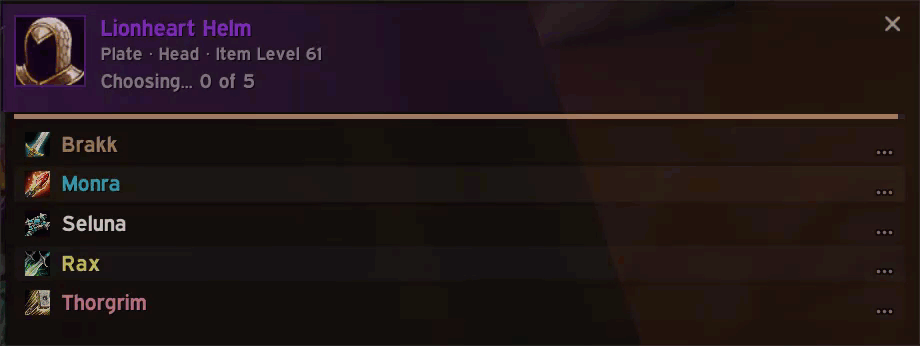

**Who Won That** puts every loot roll of your group in one small window, so you don't have to dig through chat to see who rolled what.

Made for WoW Forever.

## What it does

When something drops, the window pops up above your chat. You see the item, who picks Need, Greed or Pass as they pick it, and then the numbers come in one by one, lowest first, so the winner is always the last to land. The bars are in class colors and every class has its own little animation when its number comes in.

If anyone needs, greed rolls don't count, so those players are greyed out right away.

You also see where you stand ("You lead!", "You: #2 of 4"), and if you lose by a point or two, it tells you that too.

Between rolls the window shows who won what so far, with each player's average and best roll for the run. The luckiest one gets a star, the unluckiest a skull. And if a priest needs a plate helm, they get a ninja icon.

While the window is on, the game's own roll lines are hidden from chat. Everything else stays. Instead you get one short line per result, only for you: the item, who won it and the roll. Click the item to see its tooltip and watch the roll again.

How long the window stays after a result is up to you (10 seconds by default), or it can stay open until you close it.

## Moving it around

Drag it anywhere, drag the corner to make it wider, Ctrl + mouse wheel to scale it. It also works with Edit Mode and the EllesmereUI, ElvUI, TukUI and SpartanUI movers, and it takes the look of EllesmereUI, ElvUI or TukUI if you use one.

Closed it? `/wwt window` brings it back. Want to see it outside a dungeon? `/wwt demo`.

## Party announcements

Off by default. Turn it on and every result goes to party or raid chat as one short line:

`<WWT> [Item] (Boss) - won by Winner:94 // Second:88, Third:74 // Fourth`

If more people in the group have the addon, only one of them posts it, so there's no spam.

## Dungeon summary

After the last boss a small button shows up with what you and the others got. Click it for the full list. `/wwt summary` opens the last one again.

## Also

- Item prices from Auctionator, TradeSkillMaster, Booty Bay Broker, AuctionDB, Naowh Forever or Forever Ledger, if you have one. Cheap stuff under a limit you set is skipped.
- English, German, French, Spanish, Italian, Portuguese, Russian, Korean and Chinese.
- `/wwt` opens the settings.

It only changes how rolls are shown, it never rolls for you.

Source and bug reports: https://github.com/Monratis/WhowonThat (MIT)
