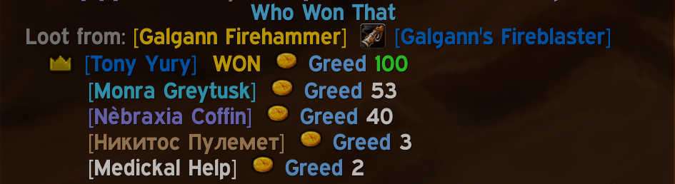

**Who Won That** turns the flood of group loot roll lines into one short summary per item: who rolled what, and who won.

**New in 4.8:** slide-out dungeon loot summary, movable pop-up button, ninja loot flag, announce to party chat that never double-posts.

## In your chat

- **One block per item** - winner first, everyone else sorted by roll, passes on one line.
- **Your chat tab** - results go to the tab you pick; other tabs are not touched.
- **Class-colored names** (your custom palette if you use one).
- **Ninja loot flag** - a Need roll on an item the class can't use (armor, weapon type or main stat) is marked in red, and the winner is called out.

## Dungeon loot summary

When a dungeon ends, a small button slides out with the dungeon name, what you won and the top winners. Click it for the full window:

- one row per player with their items (tooltips, Shift-click to link, click a name to whisper)
- a star for the top looter, your own row highlighted
- a *Details* view with item, winner and roll
- ninja loot highlighted

You can move the button anywhere (options, Edit Mode and popular UI addons). `/wwt summary` reopens the last one. Everyone / Only my items / Off in the options.

## Announce to party chat

Optional, **off by default.** Post your wins or all results to party/raid, so the whole group sees the same short line:

`<WWT> [Item] (Boss) - won by Winner:94 // Second:88, Third:74 // Fourth`

- Raid markers stand in for Need / Greed / Pass.
- The winner of a ninja loot gets a "ninja loot" note.
- **No spam:** players who have the addon talk to each other behind the scenes, so only one of them announces each item.

## Quick start

1. Install the addon and restart the game.
2. Type `/wwt`.
3. Pick a chat tab (your Party tab, or a new small *Loot* tab).

## Tips

- **A separate tab works best:** other loot messages (like "You receive loot") are hidden in the chosen tab.
- Want a quiet chat? Turn *Loot* off in every tab (right-click the tab > Settings > Loot). The addon still shows its blocks.
- `/wwt test` prints a sample roll and shows a sample loot summary.
- A quiet one-line notice appears when a group or guild member runs a newer version.

Works on its own, in party and raid. It only changes how rolls are shown, never the rolls.

Made for WoW Forever. Source and issues: https://github.com/Monratis/WhowonThat - MIT licensed.
