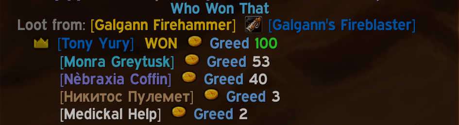

  

# Who Won That

Turns the flood of group loot roll lines into **one short summary per item**: who rolled what, and who won.

Made for **WoW Forever** (Midnight engine, Interface `16001`). No other addon needed.

## Features

- **One block per item** - winner first, everyone else sorted by roll, passes on one line.
- **Your chat tab** - results go to the tab you pick; other tabs are not touched.
- **Class-colored names** (your custom palette if you use one) and a red X on Need rolls for armor that class can't wear.
- **Detail and layout** - everyone's rolls, winner + Need/Greed, or winner only; compact layout on narrow tabs.
- **Optional group announcement** (off by default) - your wins or all results, to party/raid; skips items another player already posted.

## Quick start

1. Install via CurseForge, or copy the `WhoWonThat` folder to `<WoW Forever>\_forever_\Interface\AddOns\`, then restart the game.
2. Type `/wwt` (or Esc > Options > AddOns > Who Won That).
3. Pick a chat tab (your Party tab, or a new small *Loot* tab).

## Tips

- **A separate tab works best:** other loot messages (like "You receive loot") are hidden in the chosen tab.
- Want a quiet chat? Turn *Loot* off in every tab (right-click the tab > Settings > Loot). The addon still shows its blocks.
- **Dungeon loot summary:** when a dungeon ends, a small window lists who got which items (hover for the tooltip, Shift-click to link, "Details" for the rolls). Choose Everyone / Only my items / Off in the options; `/wwt summary` reopens it.
- Commands: `/wwt` settings, `/wwt test` sample roll and sample summary window, `/wwt summary` last dungeon summary, `/wwt help`.

## Development

- `build.ps1` builds `dist/WhoWonThat-v<version>.zip`.
- CurseForge releases are built by the [BigWigs packager](https://github.com/BigWigsMods/packager) from a `v*` tag.
- Changes: [CHANGELOG.md](CHANGELOG.md)

## License

[MIT](LICENSE)
